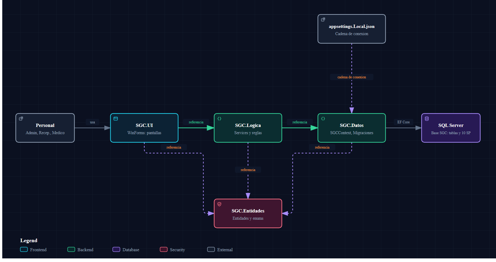

# Arquitectura del SGC

Acá vas a encontrar cómo está armado el sistema por dentro: las cuatro capas, quién depende de quién, qué pasa desde que se abre la aplicación hasta que aparece el login, y los dos patrones que se repiten en todo el código (un contexto de base de datos por operación y las clases "Fila"). Sirve para ubicarte rápido cuando tengas que tocar algo y no sepas en qué proyecto va.

El README ya tiene el resumen de capas y cómo correr el proyecto; acá se profundiza en lo que el README no cuenta.

> Todo lo que sigue fue verificado contra el código de la rama. Cuando algo no se pudo confirmar, se dice "no verificado".

---

## 1. Las cuatro capas



Fuente editable: `diagramas/capas.json` (versión interactiva en `diagramas/capas.html`).

| Proyecto | Qué es | Qué contiene | Referencia a |
|----------|--------|--------------|--------------|
| `SGC.Entidades` | Clases del dominio | `Paciente`, `Medico`, `Turno`, `Usuario`, enums (`EstadoTurno`, `RolUsuario`, `TipoExcepcionAgenda`), `PasswordHasher`, DTO de reportes (`Reportes/`) | Nadie |
| `SGC.Datos` | Acceso a SQL Server | `SGCContext` (EF Core), `SGCContextFactory`, `Migrations/`, `DbSeeder`, `StoredProcedures/*.sql` | `SGC.Entidades` |
| `SGC.Logica` | Reglas de negocio | Un `*Service` por tema (`TurnoService`, `PacienteService`, ...) y las clases "Fila" | `SGC.Datos` y `SGC.Entidades` |
| `SGC.UI` | Pantallas WinForms | `Form*.cs`, `Program.cs`, helpers de estilo | `SGC.Logica` y `SGC.Entidades` |

Esto sale de los `ProjectReference` de cada `.csproj`.

### La regla de dependencias, con dos matices

El README dice "cada capa solo referencia a la de abajo". Es cierto en lo importante (nadie referencia hacia arriba), pero hay dos detalles:

- **`SGC.Logica` y `SGC.UI` también referencian directo a `SGC.Entidades`** (se saltean la capa del medio), porque las pantallas y los servicios manejan objetos del dominio todo el tiempo.
- **`SGC.UI` no referencia a `SGC.Datos` en su `.csproj`**, pero igual lo ve por transitividad (UI → Logica → Datos). Se usa en un solo archivo: `SGC.UI/Program.cs` (para migrar la base al arrancar). Ninguna otra pantalla toca `SGCContext` ni EF Core; las pantallas siempre hablan con un `Service`.

### Por qué `PasswordHasher` vive en Entidades

Lo necesitan `UsuarioService` (Logica) y `DbSeeder` (Datos). Como Datos no puede referenciar a Logica (sería una dependencia circular), se lo puso en la capa que ambas ya ven: `SGC.Entidades/PasswordHasher.cs`. Usa PBKDF2 con sal aleatoria por usuario, 100.000 iteraciones y SHA-256, y guarda `sal_base64.hash_base64` en un solo campo.

---

## 2. Cómo arranca la aplicación

Archivo: `SGC.UI/Program.cs`, método `Main`.

```
Main
 ├─ SGCContextFactory.Crear()          → arma el contexto con la cadena de conexión
 ├─ contexto.Database.Migrate()        → crea la base si no existe y aplica migraciones pendientes
 ├─ DbSeeder.Sembrar(contexto)         → carga datos de prueba solo si no hay médicos
 ├─ (si algo falla) MessageBox + return → la app se cierra sin abrir ninguna pantalla
 └─ Application.Run(new FormLogin())
```

### Qué hace cada paso

| Paso | Qué hace | Detalle verificado |
|------|----------|--------------------|
| `Migrate()` | Aplica las migraciones de `SGC.Datos/Migrations/` que falten. Si la base no existe, la crea. | La migración que crea los procedimientos almacenados también viaja por acá (ver `05-procedimientos-almacenados.md`). |
| `DbSeeder.Sembrar` | Inserta 3 obras sociales, 3 médicos, 4 pacientes, 3 usuarios, agenda semanal y 4 turnos de hoy. | Solo corre si `contexto.Medicos.Any()` es falso: contra una base con datos no hace nada. Las contraseñas de prueba se guardan hasheadas. |
| Catálogo `TiposActividad` | Los 5 tipos de actividad **no** los siembra el `DbSeeder`: vienen de la migración (`HasData` en `SGCContext.cs`). | Ids 1 a 5. |
| `FormLogin` | Primera pantalla. | Ver sección 5. |

### Si SQL Server está apagado

`Migrate()` falla, el `catch` de `Program.cs` muestra un cuadro "No se pudo conectar/inicializar la base de datos" con el mensaje de la excepción y hace `return`: **la aplicación termina sin llegar al login**. No se verificó cuánto tarda en fallar (depende del timeout de conexión de SQL Server).

Si SQL Server responde pero cae después de arrancar, no hay una red de seguridad global: cada pantalla captura la excepción de su operación y la muestra en su franja de mensajes (por ejemplo, `FormLogin` muestra "No se pudo verificar el acceso. Verifique la conexión...").

### Cómo se encuentra la cadena de conexión

Archivo: `SGC.Datos/SGCContextFactory.cs`.

1. `BuscarAppsettingsLocal()` parte de `AppContext.BaseDirectory` (la carpeta `bin/Debug/net8.0/` desde donde corre el proceso) y **sube carpeta por carpeta** hasta encontrar una que contenga un archivo `*.sln`.
2. En esa carpeta busca `appsettings.Local.json`. Si el archivo no existe, devuelve `null`.
3. Si lo encuentra, lee la propiedad `ConnectionString` del JSON.
4. Si no hay archivo, o el JSON no tiene `ConnectionString`, usa el valor por defecto:
   `Server=.;Database=SGC;Trusted_Connection=True;TrustServerCertificate=True;`

| Situación | Resultado |
|-----------|-----------|
| Existe `appsettings.Local.json` junto al `.sln` | Usa esa cadena |
| No existe | Usa `Server=.` (la instancia por defecto del equipo) |
| Existe pero sin `ConnectionString` | Usa `Server=.` |
| Corriendo desde otra carpeta fuera del árbol del `.sln` | No lo encuentra, usa `Server=.` |

**Por qué se hizo así:** cada integrante tiene su propia instancia de SQL Server (por ejemplo `.\SQLEXPRESS` o `.\NICO_SERV1`). El archivo `appsettings.Local.json` está en el `.gitignore`, así que cada uno tiene el suyo sin pisarse; `appsettings.example.json` es la plantilla que sí está versionada. Subir hasta el `.sln` hace que funcione igual con F5, con el `.exe` directo o con `dotnet ef` desde consola.

`SGCContextDesignTimeFactory` reutiliza `SGCContextFactory.Crear()` para que las herramientas `dotnet ef` (crear migraciones) puedan instanciar el contexto sin depender de que `SGC.UI` sea el proyecto de inicio.

---

## 3. Patrón de acceso a datos: un contexto por operación

No hay inyección de dependencias ni un contexto compartido. Cada método de un `Service` hace esto:

```csharp
using var contexto = SGCContextFactory.Crear();
// ... consultar o modificar ...
contexto.SaveChanges();
```

Es decir, abre un `SGCContext`, trabaja y lo descarta al salir del método (`using`). `SGCContextFactory.Crear()` aparece unas 66 veces en `SGC.Logica`, una por operación.

| Ventaja | Consecuencia a tener en cuenta |
|---------|--------------------------------|
| No hay estado compartido entre pantallas: no se puede ver un dato "viejo" cacheado por el contexto. | Un objeto que devuelve un Service está **desconectado**: si lo modificás en la pantalla, no se guarda hasta que lo pases a `Modificar`. |
| Nada de contextos de larga vida que se desincronizan. | Las navegaciones (`Paciente.ObraSocial`, `Medico.ObrasSocialesAceptadas`) solo están cargadas si el Service las pidió con `Include`. Por eso los métodos de lectura hacen `Include` explícito. |
| Sin contenedor de DI (WinForms no lo trae). | Cada Service se instancia con `new` donde se usa (`private readonly TurnoService _turnoService = new();`). |

Un detalle que sale de este patrón: `Medico.ObrasSocialesAceptadasIds` y `Usuario.MedicosAsignadosIds` están marcados `[NotMapped]` (EF no los llena). Son "pegamento" para las listas con casilleros de la UI, y los Services los recalculan a mano después de leer (`SincronizarIds` en `MedicoService` y `UsuarioService`).

---

## 4. Patrón DTO "Fila"

Las clases `*Fila` (en `SGC.Logica/`) existen para las **grillas** de la UI. Una fila combina la entidad con datos calculados que no están en ninguna tabla.

| Clase | Qué agrega a la entidad | Quién la arma |
|-------|-------------------------|---------------|
| `PacienteFila` | Última visita, próximo turno, cantidad de ausencias | `PacienteService.ObtenerListado` |
| `MedicoFila` | Obras sociales activas que acepta, turnos de hoy y del mes | `MedicoService.ObtenerListado` |
| `ObraSocialFila` | Médicos que la aceptan, pacientes afiliados | `ObraSocialService.ObtenerListado` |
| `ExcepcionFila` | Estado respecto de hoy (Vigente/Próxima/Pasada), turnos afectados | `ExcepcionAgendaService.ObtenerListado` |
| `AgendaSemanalFila` | Franjas del médico de lunes a domingo, horas semanales | `AgendaMedicoService.ObtenerResumenSemanal` |
| `AtencionFila` | Historial clínico + bandera de si se muestran los datos clínicos | `ActividadMedicaService.ConsultarFilas` |
| `TurnoAgendaItem` | Edad, obra social, "Nuevo/Recurrente" (definida en `AgendaDiariaService.cs`) | `AgendaDiariaService.ObtenerAgenda` |

**Por qué existen:**

1. **Evitar consultas por fila.** Calcular "próximo turno" o "turnos del mes" dentro de la grilla dispararía una consulta por cada paciente o médico. Los Services traen todo en 2 o 3 consultas agrupadas y arman las filas en memoria (los comentarios de cada método dicen cuántas consultas hace).
2. **Separar lo que muestra la pantalla de lo que se guarda.** Los datos calculados no ensucian las entidades.
3. **Hacer cumplir una regla de seguridad en un solo lugar.** `AtencionFila` solo devuelve motivo, procedimiento y receta si `IncluyeDatosClinicos` es verdadero; si no, devuelve cadena vacía. Ninguna grilla ni tooltip puede mostrarlos por descuido. Detalle en `03-reglas-de-negocio.md`.

Hay otro grupo de DTO que no son "Fila" de pantalla sino **resultados de procedimientos almacenados**: `ReporteTurnoFila`, `ReporteRecaudacionFila`, `ReporteAsistenciaFila`, `ReporteOcupacionFila` y `ResumenDelDiaFila` en `SGC.Entidades/Reportes/`, más `ReporteMensualItem`, `ReporteObraSocialItem` y `ReporteMedicoRendimientoItem` en `SGC.Entidades/Reportes.cs`. Sus nombres de propiedad coinciden con las columnas del procedimiento (ver `05-procedimientos-almacenados.md`).

---

## 5. Sesión, usuario activo y roles

**No hay un objeto de sesión global.** No existe una clase estática con "el usuario actual" (no verificado en ningún `Sesion`/`static Usuario`: la búsqueda en `SGC.UI` y `SGC.Logica` no encontró ninguno). El usuario viaja **por constructor**:

```
FormLogin  →  AutenticacionService.Autenticar(usuario, clave)
              └─ UsuarioService.BuscarPorCredenciales
FormLogin  →  new FormMenuPrincipal(usuario)
FormMenuPrincipal → new FormPacientes(_usuarioActivo), new FormTurnos(_usuarioActivo), ...
```

### Cómo se autentica

`UsuarioService.BuscarPorCredenciales`:

1. Busca por `NombreUsuario` y `Activo` (el hash no se puede comparar en SQL).
2. Verifica la clave en memoria con `PasswordHasher.Verificar`.
3. Devuelve el `Usuario` con `Medico` y `MedicosAsignados` ya cargados, o `null`.

### Roles (`RolUsuario`)

| Valor | Rol | Qué lo distingue |
|-------|-----|------------------|
| 0 | `Administrador` | Ve todo. Configura médicos, horarios, usuarios, obras sociales y ausencias. |
| 1 | `Recepcionista` | Tiene una lista de médicos asignados (`Usuario.MedicosAsignados`, tabla `UsuarioMedico`). Solo ve y agenda con esos médicos. |
| 2 | `Medico` | Está vinculado a un único `Medico` (`Usuario.MedicoId`). Es el único rol que ve datos clínicos. |

El número importa: la base tiene un índice filtrado `[Rol] = 2` y un CHECK `Rol <> 2 OR MedicoId IS NOT NULL`. Ver `02-modelo-de-datos.md`.

### Quién ve qué menú

`FormMenuPrincipal.ConfigurarBotonesPorRol` muestra u oculta botones según el rol:

| Botón | Administrador | Recepcionista | Médico |
|-------|:-:|:-:|:-:|
| Inicio | sí | sí | sí |
| Pacientes, Turnos | no | sí | no |
| Médicos, Horarios, Usuarios, Obras Sociales, Ausencias | sí | no | no |
| Agenda, Actividad, Historial | no | no | sí |
| Reportes | sí | sí | sí |

`FormReportes` luego limita el alcance según el rol (por ejemplo, la pestaña de recaudación solo aparece para el administrador). El detalle de reglas por rol está en `03-reglas-de-negocio.md`.

---

## Hallazgos

Hechos observados en el código, sin juicio.

| # | Hallazgo | Dónde |
|---|----------|-------|
| 1 | **Cerrar sesión no termina el proceso.** `Program.cs` hace `Application.Run(new FormLogin())` y `FormLogin` se oculta (`Hide()`) al entrar. `BtnCerrarSesion_Click` crea un `FormLogin` nuevo y cierra el menú, pero el login original sigue oculto y es el que gobierna el ciclo de vida de la aplicación: al cerrar el login nuevo, el proceso queda vivo. Deducido del código; no se ejecutó la app para comprobarlo. | `SGC.UI/FormLogin.cs`, `SGC.UI/FormMenuPrincipal.cs` (`BtnCerrarSesion_Click`) |
| 2 | **El README está desactualizado** respecto del código: dice que no hay base de datos conectada y que los datos viven en listas en memoria, pero hoy todo pasa por EF Core y SQL Server. Las contraseñas de prueba que lista (`admin123`, `recepcion123`, `medico123`) coinciden con las del `DbSeeder`. | `README.md`, `SGC.Datos/DbSeeder.cs` |
| 3 | **Hay dos servicios con datos en memoria**, no persistidos: `HorarioService` (lista estática de slots, solo genera franjas para el combo de turnos) y `NotificacionService` (lista estática de avisos; los "emails" son simulados). Se pierden al cerrar la app. | `SGC.Logica/HorarioService.cs`, `SGC.Logica/NotificacionService.cs` |
| 4 | **La cadena por defecto es `Server=.`**: si alguien no crea su `appsettings.Local.json`, la app intenta la instancia por defecto del equipo, no `SQLEXPRESS`. | `SGC.Datos/SGCContextFactory.cs` |

## Para seguir leyendo

- Tablas, relaciones y restricciones reales: [`02-modelo-de-datos.md`](02-modelo-de-datos.md)
- Qué valida cada Service: [`03-reglas-de-negocio.md`](03-reglas-de-negocio.md)
- Procedimientos almacenados y cómo se despliegan: [`05-procedimientos-almacenados.md`](05-procedimientos-almacenados.md)
