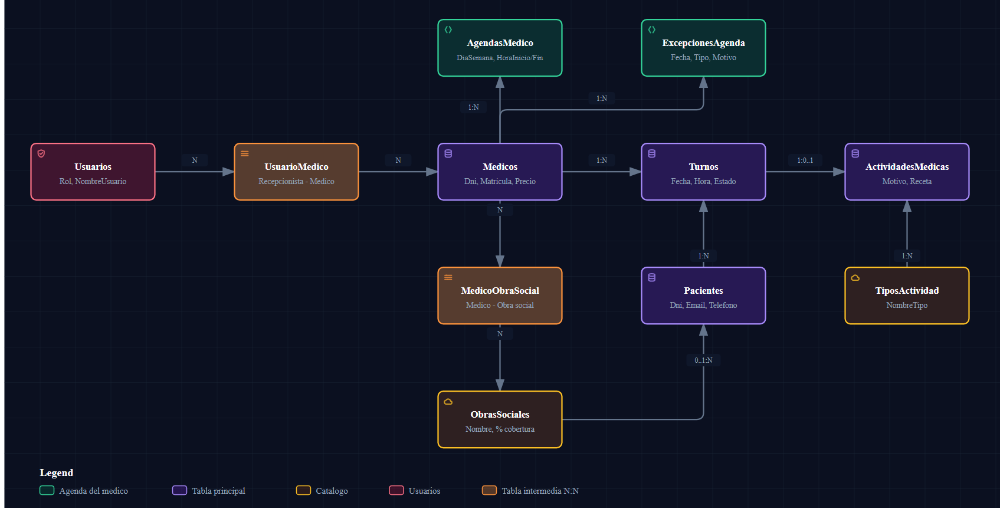

# Modelo de datos

Acá vas a encontrar qué tablas tiene la base `SGC`, para qué sirve cada una, cómo se relacionan, qué números significan los enums y qué restricciones (CHECK e índices únicos) tiene la base **de verdad**. Sirve para saber qué se puede guardar, qué rechaza SQL Server aunque el código C# no lo valide, y por qué a veces un alta "válida" falla.

Las restricciones de este documento se consultaron contra la base real (`sys.check_constraints`, `sys.indexes`, `sys.foreign_keys`) y se cruzaron con `SGC.Datos/SGCContext.cs` y las migraciones. Los nombres de tabla son los de la base (en plural: `Pacientes`, `Medicos`, `Turnos`...).

---

## 1. Diagrama

Fuente editable: `diagramas/modelo-datos.json` (versión interactiva en `diagramas/modelo-datos.html`).

> **Aclaración:** archify no tiene un tipo "entidad-relación". El diagrama usa el tipo `architecture` como **esquema de cajas y relaciones**: cada caja es una tabla y la flecha va del lado "1" al lado "N". Para no saturarlo no se dibuja `Usuarios.MedicoId` (Usuario → Medico, solo para el rol Médico); está explicado en la sección 3.

---

## 2. Entidades (tablas)

Todas las tablas de negocio tienen `Id` (clave primaria autonumérica) y `Activo` (baja lógica, ver sección 6). Los campos calculados de las clases (`NombreCompleto`, `HoraFin`, `HorarioRango`, `Edad`, ...) **no son columnas**: EF Core ignora las propiedades de solo lectura.

### `Pacientes` — `SGC.Entidades/Paciente.cs`

| Campo | Tipo en la base | Para qué sirve |
|-------|-----------------|----------------|
| `Dni` | nvarchar(15), único | Identificador de la persona |
| `Nombre`, `Apellido` | nvarchar(80) | Datos personales |
| `Email` | nvarchar(120) | Contacto (los avisos se "envían" acá, simulado) |
| `Telefono` | nvarchar(30) | Contacto |
| `FechaNacimiento` | date | Calcula la edad (`Paciente.CalcularEdad`) |
| `ObraSocialId` | int, **nulo** | FK a `ObrasSociales`. **Nulo = Particular** (no existe una fila "Particular") |

### `Medicos` — `SGC.Entidades/Medico.cs`

| Campo | Tipo | Para qué sirve |
|-------|------|----------------|
| `Dni` | nvarchar(15), único | Identificador |
| `Nombre`, `Apellido`, `Especialidad` | nvarchar(80) | Datos profesionales |
| `Matricula` | nvarchar(30), único | Matrícula profesional |
| `PrecioConsultaParticular` | decimal(10,2) | Base de la regla de cobro |

### `ObrasSociales` — `SGC.Entidades/ObraSocial.cs`

| Campo | Tipo | Para qué sirve |
|-------|------|----------------|
| `Nombre` | nvarchar(100), único | Nombre de la obra social |
| `PorcentajeCobertura` | decimal(5,2), entre 0 y 100 | Cuánto cubre sobre el precio particular |

### `Turnos` — `SGC.Entidades/Turno.cs`

| Campo | Tipo | Para qué sirve |
|-------|------|----------------|
| `PacienteId`, `MedicoId` | int, FK | Quién y con quién |
| `Fecha` | date | Día del turno |
| `HoraInicio` | time | Hora de inicio. `HoraFin` se **calcula** (`HoraInicio + DuracionMinutos`), no existe como columna |
| `DuracionMinutos` | int, mayor a 0, default 30 | Duración |
| `Estado` | int | Ver `EstadoTurno` en la sección 4 |
| `MedioPago` | nvarchar(30), nulo | Texto libre: la pantalla guarda "Particular" o el nombre de la obra social |
| `Monto` | decimal(10,2), nulo, no negativo | Lo cobrado; solo se completa al confirmar asistencia |

### `ActividadesMedicas` — `SGC.Entidades/ActividadMedica.cs`

La historia clínica de un turno. **Es el único lugar con datos clínicos.**

| Campo | Tipo | Para qué sirve |
|-------|------|----------------|
| `TurnoId` | int, FK, **único** | Un turno tiene a lo sumo una actividad (1 a 0..1) |
| `TipoActividadId` | int, FK | Tipo de atención |
| `MotivoConsulta` | nvarchar(500), obligatorio | Por qué vino (`LEN > 0`) |
| `RecetaMedicamentos`, `Procedimiento` | nvarchar(500) | Texto clínico |

### `TiposActividad` — `SGC.Entidades/TipoActividad.cs`

Catálogo fijo de 5 tipos (Consulta General, Control / Seguimiento, Estudio / Practica, Receta / Prescripcion, Certificado Medico), sembrado por la migración inicial con `HasData`. Campos: `NombreTipo` (único), `Descripcion`, `DuracionSugeridaMinutos` (mayor a 0, default 30).

### `AgendasMedico` — `SGC.Entidades/AgendaMedico.cs`

La **agenda semanal** del médico: una fila por franja (por ejemplo "lunes de 8:00 a 13:00").

| Campo | Tipo | Para qué sirve |
|-------|------|----------------|
| `MedicoId` | int, FK | De quién es la franja |
| `DiaSemana` | int | `DayOfWeek` de C#: 0=Domingo, 1=Lunes ... 6=Sábado |
| `HoraInicio`, `HoraFin` | time, `HoraFin > HoraInicio` | La franja |

### `ExcepcionesAgenda` — `SGC.Entidades/ExcepcionAgenda.cs`

Ausencias puntuales del médico (vacaciones, congreso, un rato libre).

| Campo | Tipo | Para qué sirve |
|-------|------|----------------|
| `MedicoId` | int, FK | Quién se ausenta |
| `Fecha` | date | Qué día |
| `Tipo` | int | 0=DiaCompleto, 1=RangoHorario (ver sección 4) |
| `HoraInicio`, `HoraFin` | time, nulos | Solo para `RangoHorario` |
| `Motivo` | nvarchar(200), obligatorio | Por qué |

### `Usuarios` — `SGC.Entidades/Usuario.cs`

| Campo | Tipo | Para qué sirve |
|-------|------|----------------|
| `NombreUsuario` | nvarchar(50), único | Login |
| `Contrasena` | nvarchar(200) | **Hash** PBKDF2 `sal.hash` (no la clave) |
| `Rol` | int | Ver `RolUsuario` en la sección 4 |
| `MedicoId` | int, nulo, FK | Solo para el rol Médico: a qué médico corresponde |

### Tablas intermedias (N:N)

Las crea EF Core a partir de `HasMany(...).WithMany().UsingEntity(...)` en `SGCContext.cs`. No tienen clase propia.

| Tabla | Une | Columnas | Clave primaria |
|-------|-----|----------|----------------|
| `MedicoObraSocial` | Qué obras sociales acepta cada médico | `MedicoId`, `ObrasSocialesAceptadasId` | Compuesta (ambas) |
| `UsuarioMedico` | Qué médicos atiende cada recepcionista | `UsuarioId`, `MedicosAsignadosId` | Compuesta (ambas) |

### Lo que existe en C# pero no en la base

- **`Horario`** (`SGC.Entidades/Horario.cs`): no es tabla. `HorarioService` la usa solo como generador de franjas en memoria para el combo de turnos. No hay `DbSet<Horario>` ni tabla `Horarios` (verificado en la base).
- **`sysdiagrams`** y sus procedimientos `sp_*diagram*`: están en la base de desarrollo (los crea SSMS al guardar un diagrama), pero **no** forman parte del modelo ni de las migraciones.

---

## 3. Relaciones

| Relación | Tipo | Columna / tabla | Al borrar la fila padre |
|----------|------|-----------------|-------------------------|
| Paciente → ObraSocial | N:1 opcional | `Pacientes.ObraSocialId` (nulo = Particular) | Sin acción (NO ACTION) |
| Medico ↔ ObraSocial | **N:N** | `MedicoObraSocial` | Cascada sobre la fila intermedia |
| Usuario ↔ Medico (recepcionista) | **N:N** | `UsuarioMedico` | Cascada sobre la fila intermedia |
| Usuario → Medico (rol Médico) | N:1 opcional | `Usuarios.MedicoId` | Sin acción |
| AgendaMedico → Medico | N:1 | `AgendasMedico.MedicoId` | Sin acción |
| ExcepcionAgenda → Medico | N:1 | `ExcepcionesAgenda.MedicoId` | Sin acción |
| Turno → Paciente | N:1 | `Turnos.PacienteId` | Sin acción |
| Turno → Medico | N:1 | `Turnos.MedicoId` | Sin acción |
| ActividadMedica → Turno | 1:0..1 | `ActividadesMedicas.TurnoId` (único) | **Cascada**: si se borrara un turno, se borra su actividad |
| ActividadMedica → TipoActividad | N:1 | `ActividadesMedicas.TipoActividadId` | Sin acción |

**Por qué casi todo es "sin acción" (Restrict):** la app nunca borra físicamente, usa baja lógica. Además, `Medico` y `Paciente` se referencian desde varias tablas y SQL Server no permite varios caminos de cascada a la misma tabla (lo dice el comentario de `SGCContext.cs`). Las únicas cascadas son las de las tablas intermedias y la de `ActividadesMedicas.TurnoId`.

### Los dos vínculos Usuario ↔ Medico no son lo mismo

| Vínculo | Rol | Cardinalidad | Cómo se protege |
|---------|-----|--------------|-----------------|
| `Usuarios.MedicoId` | Médico | Un usuario Médico ↔ un médico | Índice único filtrado `UQ_Usuario_MedicoUnico` (`[Rol] = 2`) y CHECK `CK_Usuario_RolMedico` |
| `UsuarioMedico` | Recepcionista | Un usuario ↔ varios médicos | Solo PK compuesta |

`UsuarioService` completa uno u otro según el rol y deja vacío el que no corresponde (`MedicoId = null` si no es Médico; lista vacía si no es Recepcionista).

---

## 4. Enums y sus números

EF Core guarda los enums como **entero** (columna `int`). Si agregás o reordenás un valor del enum, cambia el significado de los datos viejos y de los procedimientos que comparan contra el número.

### `EstadoTurno` (`Turnos.Estado`)

| N | Nombre | Quién lo asigna |
|---|--------|-----------------|
| 0 | `Pendiente` | **Ninguna pantalla ni servicio lo crea.** Existe en el enum (y es el valor por defecto de la propiedad `Turno.Estado`), pero `TurnoService.AsignarTurno` siempre inserta `Confirmado`. Solo aparece en datos cargados a mano o por el script de demo (`SGC.Datos/Scripts/carga_masiva_demo.sql`). |
| 1 | `Confirmado` | `TurnoService.AsignarTurno` (así nace todo turno) |
| 2 | `Cancelado` | `TurnoService.CancelarTurno`; `ExcepcionAgendaService.Agregar` (cancela turnos afectados) |
| 3 | `Asistio` | `TurnoService.ConfirmarAsistencia(asistio: true)` |
| 4 | `Ausente` | `TurnoService.ConfirmarAsistencia(asistio: false)` |

Los procedimientos almacenados comparan contra estos números (`Estado = 3` es "atendido"). Los comentarios de los `.sql` repiten la tabla.

### `RolUsuario` (`Usuarios.Rol`)

| N | Nombre |
|---|--------|
| 0 | `Administrador` |
| 1 | `Recepcionista` |
| 2 | `Medico` |

El `2` está escrito a mano en `SGCContext.cs` (`HasFilter("[Rol] = 2")` y `CK_Usuario_RolMedico`). Si se reordena el enum, esas dos restricciones quedan apuntando al rol equivocado.

### `TipoExcepcionAgenda` (`ExcepcionesAgenda.Tipo`)

| N | Nombre | Significado |
|---|--------|-------------|
| 0 | `DiaCompleto` | El médico no atiende ese día; `HoraInicio` y `HoraFin` deben ser nulas |
| 1 | `RangoHorario` | No atiende entre `HoraInicio` y `HoraFin` (obligatorias, con `HoraFin > HoraInicio`) |

### `DayOfWeek` (`AgendasMedico.DiaSemana`)

Es el enum de .NET: 0=Domingo, 1=Lunes, 2=Martes, 3=Miércoles, 4=Jueves, 5=Viernes, 6=Sábado. Los procedimientos calculan el día de la semana con la misma numeración (ver `05-procedimientos-almacenados.md`).

### Enums que **no** se guardan en la base

| Enum | Dónde vive | Para qué |
|------|-----------|----------|
| `EstadoExcepcion` (Vigente/Proxima/Pasada) | `SGC.Logica/ExcepcionFila.cs` | Se calcula comparando la fecha con hoy |
| `AgrupacionRecaudacion` (Medico/MedioPago/ObraSocial) | `SGC.Entidades/Reportes/` | Parámetro de `sp_ReporteRecaudacion` |

---

## 5. Restricciones de la base (consultadas con `sqlcmd`)

### CHECK (19)

| Tabla | Nombre | Condición | Qué evita |
|-------|--------|-----------|-----------|
| `ActividadesMedicas` | `CK_ActividadMedica_Motivo` | `LEN(MotivoConsulta) > 0` | Motivo vacío |
| `AgendasMedico` | `CK_AgendaMedico_Rango` | `HoraFin > HoraInicio` | Franja invertida |
| `ExcepcionesAgenda` | `CK_ExcepcionAgenda_Tipo` | `(Tipo=0 y horas nulas) o (Tipo=1 y horas informadas y HoraFin > HoraInicio)` | Combinaciones incoherentes |
| `Medicos` | `CK_Medico_Precio` | `PrecioConsultaParticular >= 0` | Precio negativo |
| `Medicos` | `CK_Medico_Nombre`, `CK_Medico_Apellido`, `CK_Medico_Especialidad` | `campo NOT LIKE '%[0-9]%'` | Números en el texto |
| `Medicos` | `CK_Medico_Dni_NoCero` | `Dni <> REPLICATE('0', LEN(Dni))` | DNI "0000000" |
| `ObrasSociales` | `CK_ObraSocial_Porcentaje` | `PorcentajeCobertura BETWEEN 0 AND 100` | Porcentaje fuera de rango |
| `Pacientes` | `CK_Paciente_FechaNacimiento` | `FechaNacimiento <= hoy` | Nacer en el futuro |
| `Pacientes` | `CK_Paciente_Nombre`, `CK_Paciente_Apellido` | `NOT LIKE '%[0-9]%'` | Números en el texto |
| `Pacientes` | `CK_Paciente_Telefono` | `NOT LIKE '%[^0-9]%' AND LEN BETWEEN 6 AND 15` | Teléfono con letras o largo raro |
| `Pacientes` | `CK_Paciente_Dni_NoCero` | `Dni <> REPLICATE('0', LEN(Dni))` | DNI "0000000" |
| `TiposActividad` | `CK_TipoActividad_Duracion` | `DuracionSugeridaMinutos > 0` | Duración nula o negativa |
| `Turnos` | `CK_Turno_Duracion` | `DuracionMinutos > 0` | Duración nula o negativa |
| `Turnos` | `CK_Turno_Monto` | `Monto IS NULL OR Monto >= 0` | Monto negativo |
| `Usuarios` | `CK_Usuario_NombreUsuario` | `LEN >= 3 AND NOT LIKE '%[^a-zA-Z0-9_.]%'` | Usuario corto o con caracteres raros |
| `Usuarios` | `CK_Usuario_RolMedico` | `Rol <> 2 OR MedicoId IS NOT NULL` | Usuario Médico sin médico |

(Las 9 restricciones de formato de la migración `RestriccionesFormato` son las de nombre, apellido, especialidad, teléfono, DNI no cero y `CK_Usuario_NombreUsuario`.)

**Por qué la base repite validaciones que ya hace C#:** es una red de seguridad. El comentario de `SGCContext.cs` aclara que C# valida con `char.IsLetter` (acepta acentos y eñes) y T-SQL `LIKE` no puede replicarlo exacto, así que la base rechaza solo el caso concreto (dígitos en nombres), no es un espejo uno a uno.

### Índices únicos (9)

| Tabla | Índice | Columnas | Filtro |
|-------|--------|----------|--------|
| `Medicos` | `IX_Medicos_Dni` | `Dni` | — |
| `Medicos` | `IX_Medicos_Matricula` | `Matricula` | — |
| `Pacientes` | `IX_Pacientes_Dni` | `Dni` | — |
| `ObrasSociales` | `IX_ObrasSociales_Nombre` | `Nombre` | — |
| `TiposActividad` | `IX_TiposActividad_NombreTipo` | `NombreTipo` | — |
| `Usuarios` | `IX_Usuarios_NombreUsuario` | `NombreUsuario` | — |
| `Usuarios` | `UQ_Usuario_MedicoUnico` | `MedicoId` | `[Rol] = 2` |
| `AgendasMedico` | `IX_AgendasMedico_MedicoId_DiaSemana_HoraInicio_HoraFin` | `MedicoId, DiaSemana, HoraInicio, HoraFin` | — |
| `ActividadesMedicas` | `IX_ActividadesMedicas_TurnoId` | `TurnoId` | — |

(Además hay índices comunes sobre las claves foráneas, como `IX_Turnos_MedicoId` e `IX_Turnos_PacienteId`. `UK_principal_name` es de `sysdiagrams` y no cuenta.)

> **Ojo:** ninguno de estos índices filtra por `Activo`. El único con filtro es `UQ_Usuario_MedicoUnico`, y filtra por `Rol`, no por `Activo`. Consecuencias en la sección 6.

### Claves foráneas y comportamiento al borrar

Resumen de lo consultado en `sys.foreign_keys`: todas son NO ACTION excepto `MedicoObraSocial` (2 FK), `UsuarioMedico` (2 FK) y `ActividadesMedicas.TurnoId`, que son CASCADE. Coincide con la tabla de la sección 3.

---

## 6. Baja lógica (`Activo`) y sus consecuencias

Nunca se borra una fila: "eliminar" en las pantallas pone `Activo = false` (métodos `EliminarLogico` de cada Service). Un turno cancelado también queda con `Activo = false` **y** `Estado = Cancelado`.

| Consecuencia | Detalle | Dónde se ve |
|--------------|---------|-------------|
| **Los índices únicos incluyen filas inactivas.** | Un médico dado de baja sigue ocupando su DNI y su matrícula. Si lo querés volver a dar de alta (mismo DNI), SQL Server rechaza el `INSERT`. Lo mismo con paciente (DNI), obra social (nombre), usuario (nombre) y franja de agenda (mismo médico, día y horas). | Índices de la sección 5 |
| **Los servicios validan duplicados solo contra filas activas.** | `MedicoService.Validar`, `PacienteService.Validar`, `ObraSocialService.Validar` y `UsuarioService.Validar` buscan duplicados con `Activo && ...`. Pasan la validación C# y recién fallan en la base (`SaveChanges` lanza excepción). No se ejecutó para ver el texto exacto que muestra la pantalla. | `SGC.Logica/*Service.cs` |
| **La matrícula del médico solo la controla la base.** | `MedicoService.Validar` verifica que no esté vacía, pero **no** busca matrículas duplicadas; el único control es `IX_Medicos_Matricula`. | `SGC.Logica/MedicoService.cs` |
| **Solo los usuarios se pueden reactivar desde la app.** | `UsuarioService.Reactivar` es el único método de reactivación. Para el resto de las entidades la baja es irreversible desde las pantallas. | `SGC.Logica/UsuarioService.cs` |
| **Los listados filtran por `Activo`, algunos `ObtenerPorId` no.** | Por ejemplo `MedicoService.ObtenerPorId` y `AgendaMedicoService.ObtenerPorId` devuelven también filas inactivas. | `SGC.Logica/` |
| **Dar de baja no limpia lo vinculado.** | `MedicoService.EliminarLogico` no mira turnos futuros ni el usuario vinculado; `ObraSocialService.EliminarLogico` no mira pacientes afiliados ni médicos que la aceptan. | Código de los Services |
| **Un turno cancelado no se ve en los listados normales.** | `TurnoService.ObtenerTodos` filtra `Activo` salvo que se pida incluir cancelados. Los procedimientos de reporte no filtran todos igual (ver `05-procedimientos-almacenados.md`). | `SGC.Logica/TurnoService.cs` |

---

## Hallazgos

Hechos observados, sin juicio.

| # | Hallazgo | Dónde |
|---|----------|-------|
| 1 | **No se puede recrear un médico, paciente, obra social, usuario ni franja de agenda dado de baja con los mismos datos únicos**, porque los índices únicos no excluyen filas inactivas. Para `Usuario` hay una salida (`Reactivar`); para los demás no hay reactivación en la app. | Índices en `SGC.Datos/SGCContext.cs` |
| 2 | **Mensajes y valores sin tildes en la base y en el código:** especialidades sembradas como "Clinica General", "Cardiologia", "Pediatria"; tipos de actividad ("Estudio / Practica", "Receta / Prescripcion", "Certificado Medico"); `AgendaMedico.NombreDia` devuelve "Miercoles" y "Sabado"; muchos mensajes de los Services no llevan tildes. Parte es una convención declarada en el README (evitar tildes en strings por problemas de codificación), pero otros archivos sí usan tildes (`DisponibilidadDia.cs`, `ReporteService.cs`). | `SGC.Datos/DbSeeder.cs`, `SGCContext.cs` (`HasData`), `SGC.Entidades/AgendaMedico.cs` |
| 3 | **`Turnos.MedioPago` es texto libre** y guarda el nombre de la obra social ("OSDE", "PAMI"...) o "Particular". Un renombre de una obra social no actualiza los turnos viejos. | `SGC.UI/FormConfirmarAsistencia.cs` |
| 4 | **Validaciones de C# y de la base no son idénticas:** C# exige DNI de 7 a 8 dígitos; la base solo exige que no sea todo ceros (acepta hasta 15 caracteres). C# permite nacimiento hasta 120 años atrás; la base solo exige que no sea futuro. El email se valida solo en C# (que tenga `@` y `.`). | `PacienteService.Validar`, `SGCContext.cs` |
| 5 | **Existen 16 turnos en estado `Pendiente` en la base de desarrollo**, aunque el código nunca los crea (vienen del script de demo). Las pantallas y los reportes los muestran igual. | `SGC.Datos/Scripts/carga_masiva_demo.sql` |

## Para seguir leyendo

- Qué reglas aplica C# antes de guardar: [`03-reglas-de-negocio.md`](03-reglas-de-negocio.md)
- Procedimientos que leen estas tablas: [`05-procedimientos-almacenados.md`](05-procedimientos-almacenados.md)
