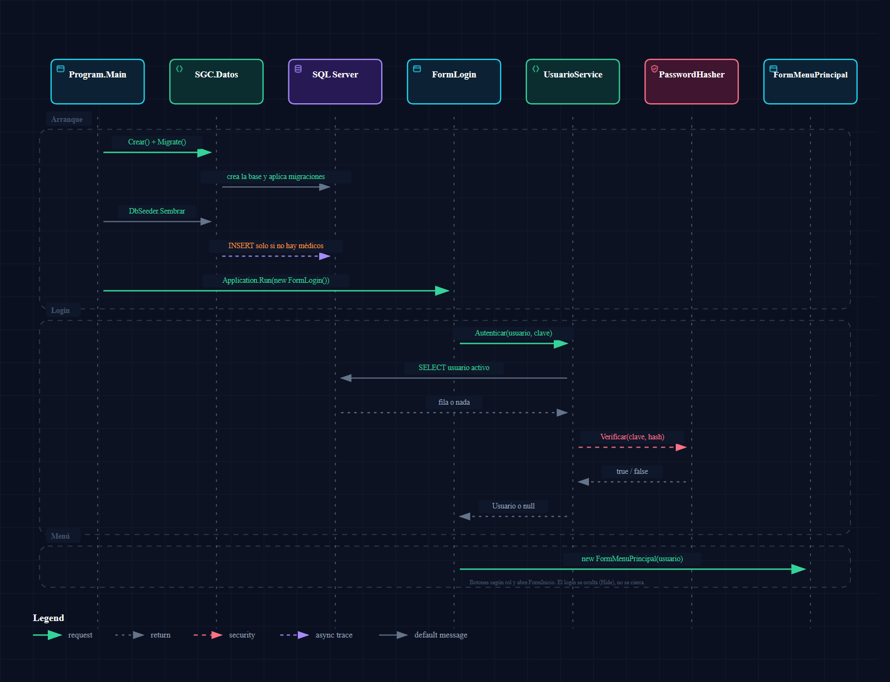
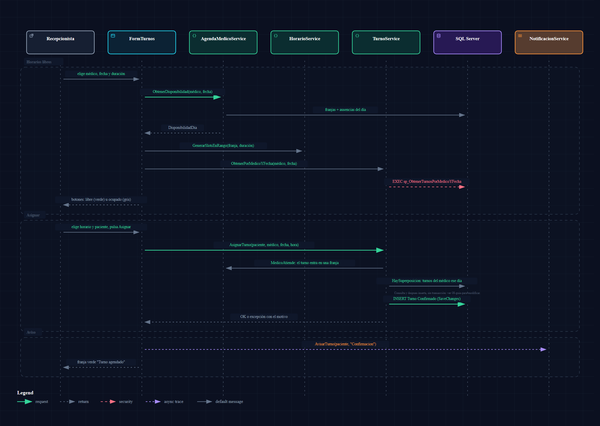
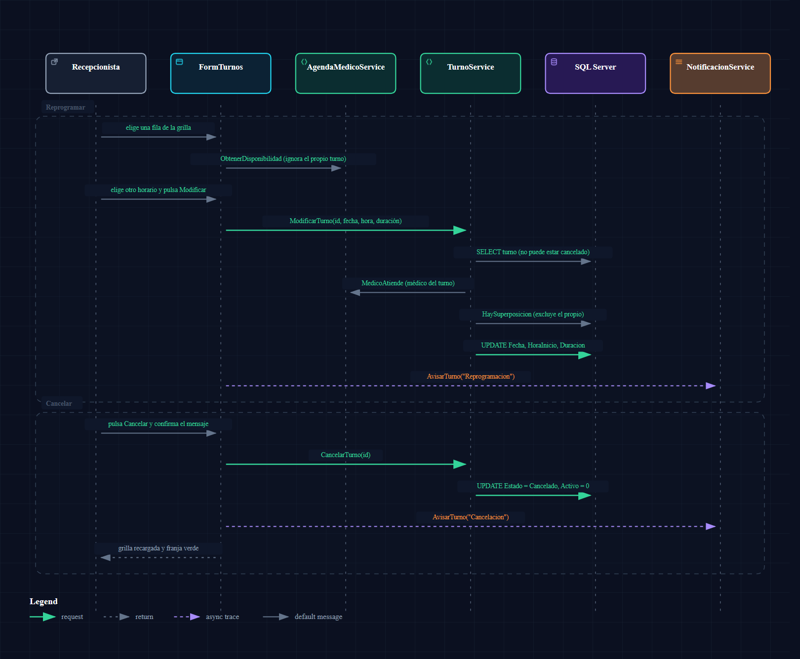
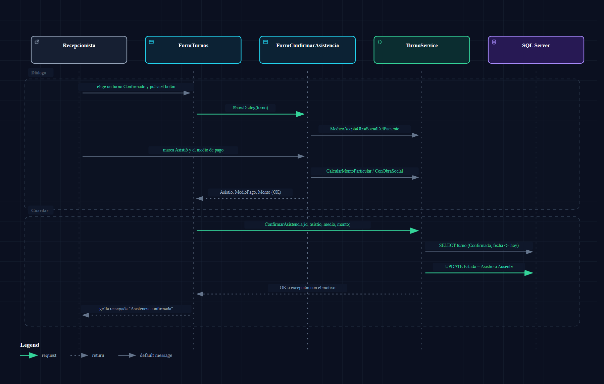
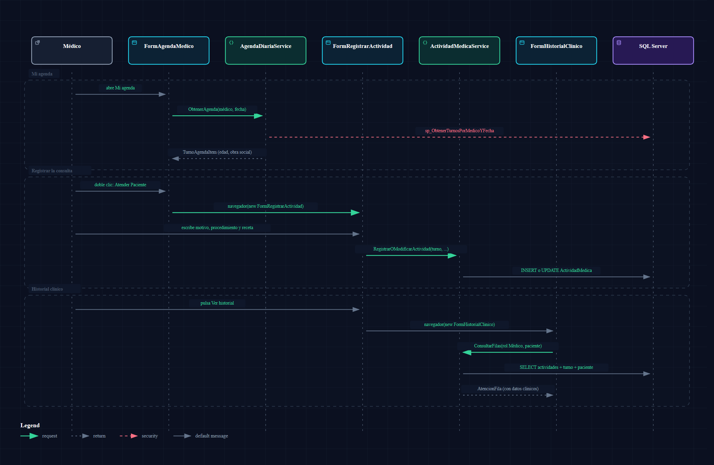
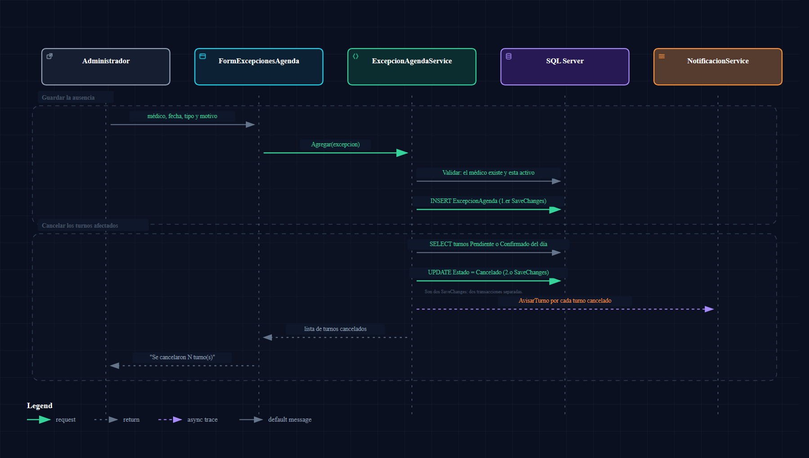
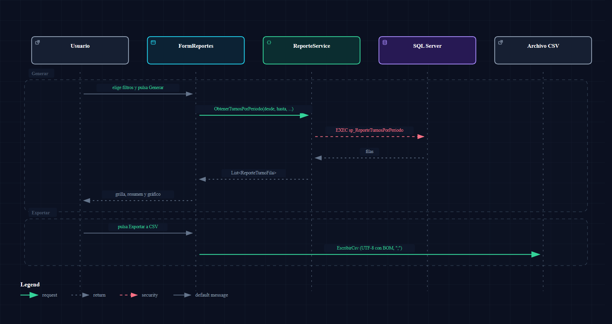
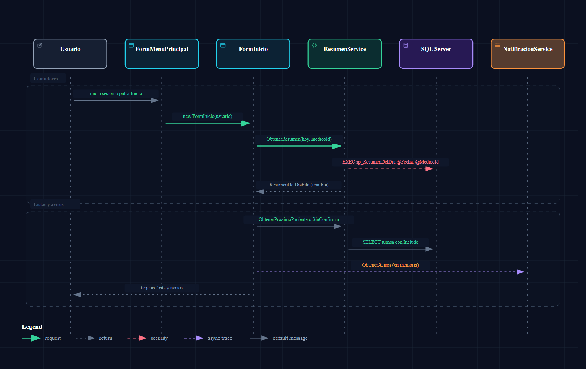

# Flujos de punta a punta

Acá vas a encontrar los 8 recorridos más importantes del sistema, **de la pantalla a la base y de vuelta**: qué archivo y qué método se ejecuta en cada paso, y por qué el código está armado así. Sirve para entender qué pasa "por debajo" cuando alguien aprieta un botón, y para saber dónde tocar si hay que cambiar algo.

Cada flujo tiene un diagrama de secuencia (las flechas van de arriba hacia abajo en el orden en que ocurren; las punteadas son respuestas), una tabla con el recorrido y un cierre con el **porqué**. Los nombres entre comillas de las franjas de mensajes son los que ve el usuario.

> Todo fue verificado leyendo el código de la rama. Lo que se dedujo sin ejecutar la aplicación se marca como "deducido". Las reglas completas de cada validación están en [`03-reglas-de-negocio.md`](03-reglas-de-negocio.md); acá solo se nombran.

| # | Flujo | Pantalla de entrada |
|---|-------|---------------------|
| a | [Arranque y login](#a-arranque-de-la-app-y-login) | `Program.cs`, `FormLogin` |
| b | [Asignar un turno](#b-asignar-un-turno) | `FormTurnos` |
| c | [Modificar y cancelar un turno](#c-modificar-y-cancelar-un-turno) | `FormTurnos` |
| d | [Confirmar asistencia y cobro](#d-confirmar-asistencia-y-cobro) | `FormTurnos` → `FormConfirmarAsistencia` |
| e | [Atención médica e historial](#e-atención-médica-e-historial-clínico) | `FormAgendaMedico` |
| f | [Cargar una ausencia](#f-cargar-una-ausencia) | `FormExcepcionesAgenda` |
| g | [Generar un reporte](#g-generar-un-reporte) | `FormReportes` |
| h | [Pantalla de Inicio](#h-pantalla-de-inicio) | `FormInicio` |

**Dos cosas que se repiten en todos los flujos** (explicadas en [`01-arquitectura.md`](01-arquitectura.md)): cada método de un Service abre su propio `SGCContext` con `SGCContextFactory.Crear()` y lo descarta al terminar, y las pantallas nunca tocan la base: siempre pasan por un Service.

---

## a) Arranque de la app y login

| Paso | Archivo y método | Qué pasa |
|------|------------------|----------|
| 1 | `SGC.UI/Program.cs` → `Main` | Crea un contexto con `SGCContextFactory.Crear()` (busca `appsettings.Local.json`, si no usa `Server=.`). |
| 2 | `contexto.Database.Migrate()` | Crea la base si no existe y aplica las migraciones que falten (incluidos los procedimientos almacenados). |
| 3 | `SGC.Datos/DbSeeder.cs` → `Sembrar` | Si **no hay ningún médico**, carga obras sociales, médicos, pacientes, usuarios, agenda y turnos de prueba. Si ya hay datos, no hace nada. |
| 4 | `Program.cs` (bloque `catch`) | Si 2 o 3 fallan (por ejemplo SQL Server apagado) muestra un `MessageBox` y **sale sin abrir ninguna pantalla**. |
| 5 | `Application.Run(new FormLogin())` | Abre el login. Desde acá `FormLogin` es la ventana principal del proceso. |
| 6 | `SGC.UI/FormLogin.cs` → `BtnIngresar_Click` | Valida que usuario y clave no estén vacíos. Llama a `new AutenticacionService().Autenticar(...)`. |
| 7 | `SGC.Logica/AutenticacionService.cs` → `Autenticar` | Delega en `UsuarioService.BuscarPorCredenciales` (no tiene lógica propia). |
| 8 | `SGC.Logica/UsuarioService.cs` → `BuscarPorCredenciales` | Busca por `NombreUsuario` **y** `Activo = true`, con `Include` de `Medico` y `MedicosAsignados`. |
| 9 | `SGC.Entidades/PasswordHasher.cs` → `Verificar` | Compara la clave tipeada con el hash guardado (PBKDF2, 100.000 iteraciones, SHA-256). Devuelve `null` si no coincide. |
| 10 | `FormLogin.BtnIngresar_Click` | Si el resultado es `null`, muestra "Usuario o contraseña incorrectos" en la `FranjaMensaje`. Si no, crea `new FormMenuPrincipal(usuario)`, lo muestra y se **oculta** (`Hide()`). |
| 11 | `SGC.UI/FormMenuPrincipal.cs` → constructor | Muestra los botones del rol (`ConfigurarBotonesPorRol`) y abre `FormInicio` (flujo [h](#h-pantalla-de-inicio)). |

**Por qué está armado así**

- **El hash no se compara en SQL.** PBKDF2 con sal aleatoria no se puede traducir a un `WHERE`, así que se busca el usuario por nombre y se verifica en memoria.
- **Mismo mensaje para "no existe" y "clave mala".** El login no revela si el usuario existe.
- **No hay sesión global.** El `Usuario` viaja por constructor: `FormLogin` → `FormMenuPrincipal` → cada pantalla hija. Por eso cada pantalla puede saber el rol sin consultar nada.
- **Cerrar sesión no termina el proceso (deducido, no ejecutado).** `BtnCerrarSesion_Click` crea un `FormLogin` nuevo y cierra el menú, pero la ventana principal del proceso sigue siendo el primer `FormLogin`, que quedó oculto. Cerrar la ventana nueva no termina la aplicación, y tampoco cerrar el menú con la X: en `SGC.UI` no hay `Application.Exit` ni manejadores de `FormClosed`.

---

## b) Asignar un turno

Se hace en dos tiempos: primero la pantalla **calcula qué horarios mostrar** y después, al apretar "Asignar", el Service **vuelve a validar todo**.

**Tiempo 1: los horarios libres como botones**

| Paso | Archivo y método | Qué pasa |
|------|------------------|----------|
| 1 | `SGC.UI/FormTurnos.cs` → `ActualizarHorarios` | Se dispara al cambiar médico, fecha o duración. Borra los botones anteriores y llama a `CrearHorarios`. |
| 2 | `SGC.Logica/AgendaMedicoService.cs` → `ObtenerDisponibilidad` | Devuelve un `DisponibilidadDia` (`SGC.Logica/DisponibilidadDia.cs`): las franjas de ese día de la semana y las ausencias activas de esa fecha. |
| 3 | `DisponibilidadDia.MotivoSinAtencion` | Si el médico no atiende ese día, no tiene agenda o tiene una ausencia de día completo, **no se crean botones** y se muestra el motivo en un aviso. |
| 4 | `SGC.Logica/HorarioService.cs` → `GenerarSlotsEnRango` | Corta cada franja en tramos de la duración elegida (15, 20, 30, 45, 60 o 90 min). Los tramos que no entran completos se descartan. |
| 5 | `SGC.Logica/TurnoService.cs` → `ObtenerPorMedicoYFecha` | Trae los turnos activos de ese médico y día con `EXEC sp_ObtenerTurnosPorMedicoYFecha` (ver [`05`](05-procedimientos-almacenados.md)). |
| 6 | `FormTurnos.CrearHorarios` / `CrearChip` | Un botón por tramo: **libre** (borde verde, clic habilitado) u **ocupado** (gris, deshabilitado) si se superpone con un turno, con una ausencia (`HayAusenciaEn`) o si la fecha ya pasó. |

**Tiempo 2: el botón "Asignar"**

| Paso | Archivo y método | Qué pasa |
|------|------------------|----------|
| 7 | `FormTurnos.BtnAsignar_Click` | Verifica que haya paciente, médico, duración y horario elegido; si falta algo lo lista en la franja de mensajes. |
| 8 | `TurnoService.AsignarTurno` | Valida en este orden: fecha no pasada, el médico atiende (`AgendaMedicoService.MedicoAtiende`), sin superposición (`HaySuperposicion`). |
| 9 | `TurnoService.AsignarTurno` | Inserta `Turno` con `Estado = Confirmado` y `Activo = true` y llama a `SaveChanges` (una sola operación). |
| 10 | `FormTurnos.BtnAsignar_Click` | Si el Service lanzó una excepción, muestra el mensaje y **vuelve a dibujar los botones** (el horario pudo ocuparse desde otra pantalla). Si salió bien, recarga la grilla. |
| 11 | `SGC.Logica/NotificacionService.cs` → `AvisarTurno` | "Avisa" al paciente: solo agrega un texto a una lista estática en memoria (no manda ningún email). Si falla, el turno ya está guardado. |

**Por qué está armado así**

- **El botón libre/ocupado es una ayuda visual, no la regla.** La regla real vive en `TurnoService.AsignarTurno`; los botones solo evitan que el usuario elija algo inválido.
- **`AsignarTurno` no llama a `sp_AsignarTurno`.** Hace sus propias validaciones en C# (nadie en el código invoca ese procedimiento; ver [`05`](05-procedimientos-almacenados.md)). Una diferencia importante: el procedimiento sí rechaza horarios con ausencia cargada y el método de C# no. Hoy lo único que impide agendar durante una ausencia es que `FormTurnos` pinta ese horario como ocupado.
- **La superposición se resuelve en memoria** porque `Turno.HoraFin` es una propiedad calculada que EF no puede traducir a SQL.
- **Hay una carrera posible.** Entre `HaySuperposicion` y el `INSERT` no hay transacción ni índice único: dos recepcionistas que asignen a la vez el mismo horario podrían crear turnos superpuestos. Detalle y arreglo propuesto en [`08-guia-para-modificar.md`](08-guia-para-modificar.md#transacciones-y-concurrencia).
- **Los horarios `Horario` no están en la base.** `HorarioService` guarda sus tramos en una lista estática en memoria; solo sirven para armar los botones.

---

## c) Modificar y cancelar un turno

| Paso | Archivo y método | Qué pasa |
|------|------------------|----------|
| 1 | `FormTurnos.DgvTurnos_SelectionChanged` | Al elegir una fila, la tarjeta de la izquierda pasa a **"REPROGRAMAR TURNO"** (`ActualizarModo`): paciente y médico quedan bloqueados, solo se cambia fecha, horario y duración. |
| 2 | `FormTurnos.ActualizarHorarios` | Recalcula los botones **ignorando el propio turno** (`idPropio`), para que el turno pueda "quedarse" en su horario actual. |
| 3 | `FormTurnos.BtnModificar_Click` | Exige un horario libre elegido y llama a `TurnoService.ModificarTurno(id, fecha, hora, duración)`. |
| 4 | `TurnoService.ModificarTurno` | Valida: fecha no pasada, el turno existe y no está cancelado, el médico **del turno** atiende, no hay superposición (excluyendo el propio turno). Actualiza `Fecha`, `HoraInicio` y `DuracionMinutos`. |
| 5 | `NotificacionService.AvisarTurno` | Aviso simulado de "Reprogramacion". |
| 6 | `FormTurnos.BtnCancelar_Click` | Pide confirmación con un `MessageBox` y llama a `TurnoService.CancelarTurno(id)`. |
| 7 | `TurnoService.CancelarTurno` | `Estado = Cancelado` **y** `Activo = false`; falla si ya estaba cancelado. |

**Por qué está armado así**

- **Cancelar no borra:** el turno queda en la base con `Activo = false` (baja lógica). Por eso la grilla lo oculta salvo que se marque "Mostrar cancelados", y los reportes lo pueden contar o no según el procedimiento (ver [`05`](05-procedimientos-almacenados.md)).
- **No se puede cambiar de médico ni de paciente** al reprogramar (requisito RF#05 citado en el código): para eso se cancela y se asigna uno nuevo.
- **Un turno ya atendido sí se puede modificar o cancelar** (ni el Service ni la pantalla lo impiden); es un defecto conocido, ver [`08`](08-guia-para-modificar.md#defectos-y-deuda-conocidos).

---

## d) Confirmar asistencia y cobro

| Paso | Archivo y método | Qué pasa |
|------|------------------|----------|
| 1 | `FormTurnos.ActualizarAcciones` | El botón se habilita solo si el turno está en estado `Confirmado` **y** su fecha es hoy o anterior. |
| 2 | `FormTurnos.BtnConfirmarAsistencia_Click` | Abre el diálogo modal `new FormConfirmarAsistencia(turno)`. |
| 3 | `SGC.UI/FormConfirmarAsistencia.cs` → constructor | Ofrece como medio de pago "Particular" y, **solo si el médico la acepta**, la obra social del paciente (`TurnoService.MedicoAceptaObraSocialDelPaciente`). |
| 4 | `FormConfirmarAsistencia.CboMedioPago_SelectedIndexChanged` | Sugiere el monto: `CalcularMontoParticular` o `CalcularMontoConObraSocial` (editable). |
| 5 | `FormConfirmarAsistencia.BtnConfirmar_Click` | Valida en pantalla (eligió Asistió/Ausente, medio de pago, monto no negativo) y devuelve `Asistio`, `MedioPagoSeleccionado` y `MontoSeleccionado`. |
| 6 | `TurnoService.ConfirmarAsistencia` | Revalida (turno existe, está `Confirmado`, la fecha no es futura, medio y monto si asistió) y guarda: `Asistio` con medio y monto, o `Ausente` con ambos en `null`. |

**La regla de cobro** (`TurnoService`, métodos estáticos): precio particular del médico; con obra social aceptada por **ese** médico, `precio − precio × cobertura / 100` (con piso en 0). Si el médico no acepta la obra social del paciente, el paciente paga particular. Ejemplo: 12.000 con 70 % de cobertura → 3.600.

**Por qué está armado así**

- **La regla de cobro vive en el Service y no en el diálogo** porque la usan dos pantallas: el diálogo (monto sugerido) y la grilla de turnos (columna "A cobrar (estimado)").
- **Se valida dos veces** (pantalla y Service) a propósito: la pantalla da respuesta rápida y el Service protege la regla aunque otra pantalla lo llame.
- **`Asistio` y `Ausente` son estados finales:** `ConfirmarAsistencia` exige `Confirmado`, así que no se puede confirmar dos veces.
- **`MedioPago` es texto libre:** guarda el nombre de la obra social o "Particular"; si después se renombra la obra social, los turnos viejos no cambian.

---

## e) Atención médica e historial clínico

Esta parte es del rol Médico (pantallas de Luciano). **Atender un turno no cambia su estado**: el turno sigue `Confirmado` y se considera "atendido" porque tiene una `ActividadMedica` activa (`Turno.EstadoAtencion`).

| Paso | Archivo y método | Qué pasa |
|------|------------------|----------|
| 1 | `FormMenuPrincipal` → botón "Mi agenda" | Abre `new FormAgendaMedico(usuario, AbrirFormularioHijo)`: se le pasa el método de navegación para poder abrir otras pantallas en el mismo panel. |
| 2 | `FormAgendaMedico.DeterminarMedicoActivo` | El médico sale de `Usuario.MedicoId`. Si el usuario no tiene médico vinculado, cae en el **primero** de `MedicoService.ObtenerTodos()` (comportamiento del código). |
| 3 | `SGC.Logica/AgendaDiariaService.cs` → `ObtenerAgenda` | Trae los turnos del día (con `sp_ObtenerTurnosPorMedicoYFecha`, incluyendo cancelados) y arma `TurnoAgendaItem` con edad, obra social y "Nuevo/Recurrente". |
| 4 | `FormAgendaMedico.CargarTurnos` | Cuenta, filtra (por defecto muestra los **pendientes de atender**) y calcula el próximo paciente con `AgendaDiariaService.ElegirProximo`. |
| 5 | `FormAgendaMedico.BtnAtender_Click` | Bloquea turnos cancelados y futuros; abre `new FormRegistrarActividad(turno, usuario, navegador)`. |
| 6 | `SGC.UI/FormRegistrarActividad.cs` → `BtnGuardar_Click` | Llama a `ActividadMedicaService.RegistrarOModificarActividad(turno, tipo, motivo, procedimiento, receta)`. |
| 7 | `SGC.Logica/ActividadMedicaService.cs` | Rechaza turno cancelado o motivo vacío; si ya hay actividad activa del turno la **actualiza**, si no la **inserta** (una por turno). |
| 8 | `FormRegistrarActividad.BtnVerHistorial_Click` | Abre `FormHistorialClinico` con ese paciente. |
| 9 | `SGC.UI/FormHistorialClinico.cs` → `CargarHistorialPaciente` | Llama a `ActividadMedicaService.ConsultarFilas(rol, paciente, médico, desde, hasta, tipo)`. |
| 10 | `SGC.Logica/AtencionFila.cs` | Devuelve motivo, procedimiento y receta **solo si el rol es Médico**; para otro rol los campos vienen vacíos. |

**Por qué está armado así**

- **Atención y asistencia son cosas distintas.** La asistencia/cobro la registra la recepción (flujo d); la atención clínica la registra el médico. No se pisan.
- **El navegador (`Action<Form>`) evita ventanas sueltas.** Las pantallas del médico se abren como hijas del menú. Cada una tiene una rama alternativa con `ShowDialog()` (y `FormHistorialPaciente`, la versión modal del historial) que **solo se usa cuando no hay navegador**; en la aplicación real el menú siempre lo pasa, así que esas ramas hoy no se ejecutan (deducido).
- **La seguridad clínica (RNF#07) está en la fila, no en la pantalla:** aunque una grilla quisiera mostrar el motivo, `AtencionFila` ya lo trae vacío para otros roles.
- **En el combo de "Registrar actividad"** cada turno lleva la marca `[Atendido]` o `[Pendiente]`: acá "Pendiente" significa "sin atención cargada", no el estado de turno (ver [`06-capa-ui.md`](06-capa-ui.md#las-dos-acepciones-de-pendiente)).

---

## f) Cargar una ausencia

| Paso | Archivo y método | Qué pasa |
|------|------------------|----------|
| 1 | `SGC.UI/FormExcepcionesAgenda.cs` → `BtnGuardar_Click` | Arma un `ExcepcionAgenda` (médico, fecha, tipo `DiaCompleto` o `RangoHorario`, horas, motivo) y llama a `Agregar` (o a `Modificar` si había una fila elegida). |
| 2 | `SGC.Logica/ExcepcionAgendaService.cs` → `Validar` | Médico existente y activo, fecha no pasada (hoy sí), motivo obligatorio, y horas coherentes si es rango. |
| 3 | `ExcepcionAgendaService.Agregar` | Inserta la ausencia (`SaveChanges` #1). |
| 4 | `ExcepcionAgendaService.CancelarTurnosAfectados` | Busca los turnos **activos** del médico en esa fecha en estado `Pendiente` o `Confirmado`; si la ausencia es de rango, solo los que se superponen. |
| 5 | `CancelarTurnosAfectados` | Los pasa a `Cancelado` con `Activo = false` y guarda (`SaveChanges` #2). Registra un aviso simulado al paciente. |
| 6 | `FormExcepcionesAgenda.BtnGuardar_Click` | Muestra "Excepción guardada correctamente. Se cancelaron N turno(s)...". |

**Qué pasa con los turnos existentes**

| Turno del médico ese día | Efecto |
|--------------------------|--------|
| `Confirmado` (o `Pendiente`) dentro de la ausencia | Se cancela solo, y se avisa (simulado) |
| `Confirmado` fuera del rango horario | No se toca |
| `Asistio` / `Ausente` | No se toca (ya están resueltos) |
| Ya cancelado | No se toca |

**Por qué está armado así**

- **Un turno en una ausencia deja de tener sentido**, por eso se cancela en el momento y no se deja para que alguien lo note.
- **Son dos `SaveChanges` seguidos, no una transacción:** si la segunda falla, la ausencia queda guardada pero los turnos no se cancelan. Ver [`08`](08-guia-para-modificar.md#transacciones-y-concurrencia).
- **Solo `Agregar` cancela turnos.** `Modificar` y `EliminarLogico` no vuelven a revisar nada: editar una ausencia no cancela turnos nuevos que queden dentro, y eliminarla no restituye los ya cancelados.
- **Las ausencias afectan a la pantalla de turnos** a través de `DisponibilidadDia` (flujo b), pero `TurnoService` no las consulta.

---

## g) Generar un reporte

El diagrama muestra la pestaña "Turnos"; todas siguen el mismo camino. El módulo completo está en [`07-reportes.md`](07-reportes.md).

| Paso | Archivo y método | Qué pasa |
|------|------------------|----------|
| 1 | `SGC.UI/FormReportes.cs` → `Generar(vista)` | Valida los filtros (`ValidarFiltros`: desde ≤ hasta, y máximo 366 días en Ocupación), pone el cursor de espera y deshabilita el botón. |
| 2 | `FormReportes.GenerarTurnos` (u otro `Generar*`) | Decide qué médico filtrar según el rol (`MedicoSeleccionado`) y llama al método de `ReporteService`. |
| 3 | `SGC.Logica/ReporteService.cs` → `ObtenerTurnosPorPeriodo` | Valida el período y ejecuta `EXEC sp_ReporteTurnosPorPeriodo` con `SqlQueryRaw<ReporteTurnoFila>`. |
| 4 | `SGC.Datos/StoredProcedures/sp_ReporteTurnosPorPeriodo.sql` | Hace el `SELECT` con los `JOIN` y devuelve las filas. |
| 5 | `FormReportes.MostrarDatos` | Asigna la lista como `DataSource` de la grilla; arma el resumen de abajo. En Recaudación y Ocupación también actualiza el gráfico (`ActualizarGrafico`). |
| 6 | `FormReportes.ExportarCsv` | Con el botón "Exportar a CSV": `SaveFileDialog` y `EscribirCsv` (UTF-8 con BOM, separador `;`). |

**Por qué está armado así**

- **La agregación vive en la base** (procedimientos) y la pantalla solo dibuja: así el cálculo es el mismo para cualquier pantalla y no se traen miles de filas para sumarlas en C#.
- **Se guarda `Encabezados` y `FilasExportacion` al generar:** el CSV exporta exactamente lo que se ve, sin volver a consultar.
- **El alcance por rol lo controla la pantalla,** no el Service ni el procedimiento (ver [`07`](07-reportes.md)). Si el Recepcionista elige "Todos mis médicos", la pantalla ejecuta el procedimiento **una vez por médico asignado** y une los resultados, porque el procedimiento recibe un solo médico.
- **Errores:** un `ArgumentException` (por ejemplo, fechas invertidas) se muestra tal cual; cualquier otra excepción se muestra como "No se pudo generar el reporte..." y limpia el resultado.

---

## h) Pantalla de Inicio

| Paso | Archivo y método | Qué pasa |
|------|------------------|----------|
| 1 | `FormMenuPrincipal.CargarPantallaInicialPorDefecto` | Todos los roles arrancan en Inicio: `new FormInicio(usuario)`. |
| 2 | `SGC.UI/FormInicio.cs` → `Cargar` | Según el rol llama a `CargarAdministrador`, `CargarMedico` o `CargarRecepcionista`. |
| 3 | `SGC.Logica/ResumenService.cs` → `ObtenerResumen` | `EXEC sp_ResumenDelDia @Fecha, @MedicoId` y devuelve **una fila** (`ResumenDelDiaFila`) con los contadores del día, la semana y el mes. |
| 4 | `ResumenService.ObtenerResumenDeMedicos` | Para la Recepcionista: llama al procedimiento una vez por médico asignado y suma con `ResumenDelDiaFila.Sumar`. Una lista vacía da todo en cero. |
| 5 | `ResumenService.ObtenerProximoPaciente` / `ObtenerProximosSinConfirmar` | Consultas con EF para el próximo paciente (Médico) y la lista de turnos en estado `Pendiente` (Recepcionista). |
| 6 | `NotificacionService.ObtenerAvisos` / `ObtenerAvisosDeMedico` | Muestra los avisos simulados **de esta sesión**: están en una lista en memoria. |

**Por qué está armado así**

- **`FormInicio` no tiene Designer:** toda la interfaz se arma en código (ver [`06-capa-ui.md`](06-capa-ui.md)). Es la excepción al patrón normal y se hizo para que el diseñador de Visual Studio no pueda borrarla.
- **Los números vienen de un solo procedimiento** para no hacer cinco consultas separadas.
- **El botón "Actualizar"** vuelve a ejecutar `Cargar`; la pantalla no se refresca sola.
- **La tarjeta "Pendientes"** cuenta turnos en **estado** `Pendiente` (valor 0). Como ninguna pantalla crea ese estado, en una base creada solo por la aplicación suele mostrar 0.

---

## Para seguir leyendo

- Las pantallas, sus servicios y el patrón visual: [`06-capa-ui.md`](06-capa-ui.md)
- El módulo de reportes por dentro: [`07-reportes.md`](07-reportes.md)
- Recetas para modificar y defectos conocidos: [`08-guia-para-modificar.md`](08-guia-para-modificar.md)
