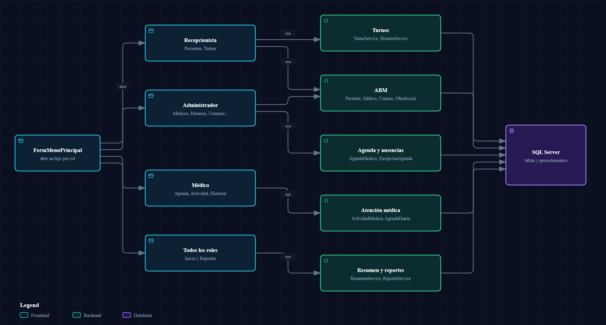

# Capa de interfaz (SGC.UI)

Acá vas a encontrar el mapa de **todas las pantallas** (qué hace cada una, qué servicio usa y para qué rol es), cómo se navega, el patrón visual que repiten, los componentes compartidos y las reglas para no romper nada al tocar un formulario. Sirve para decidir dónde agregar o cambiar una pantalla sin leer los 20 archivos.

> Verificado contra `SGC.UI/` de la rama. Lo que no se ejecutó se marca como "deducido".

## 1. Mapa de pantallas



Fuente editable: `diagramas/pantallas-servicios.json`. El diagrama agrupa por rol y por familia de servicios; la tabla de abajo tiene el detalle exacto (por ejemplo, `FormTurnos` también usa `PacienteService` y `MedicoService`).

Columna **Origen**: *Rediseñada* = usa los componentes compartidos del patrón nuevo (sección 3). *Luciano* = módulo del rol Médico hecho por Luciano Villordo, con estilo propio y sin los componentes compartidos (salvo los que se indican). *Código* = sin Designer, la interfaz se arma por código.

| Formulario | Rol | Qué hace | Servicios que usa | Origen |
|------------|-----|----------|-------------------|--------|
| `FormLogin` | Todos | Pide usuario y clave y abre el menú | `AutenticacionService` (→ `UsuarioService`) | Rediseñada |
| `FormMenuPrincipal` | Todos | Barra lateral por rol y panel donde se abren las pantallas | — | Rediseñada |
| `FormInicio` | Todos | Resumen del día según el rol (tarjetas, próximo paciente, avisos) | `ResumenService`, `NotificacionService`, `MedicoService` | Código |
| `FormPacientes` | Recepcionista | ABM de pacientes, buscador, "solo con ausencias" | `PacienteService`, `ObraSocialService` | Rediseñada |
| `FormTurnos` | Recepcionista | Asignar, reprogramar, cancelar y confirmar asistencia | `TurnoService`, `PacienteService`, `MedicoService`, `AgendaMedicoService`, `HorarioService`, `NotificacionService` | Rediseñada |
| `FormConfirmarAsistencia` | Recepcionista | Diálogo modal: Asistió/Ausente, medio de pago y monto | (usa métodos estáticos de `TurnoService`) | Rediseñada |
| `FormMedicos` | Administrador | ABM de médicos, precio y obras sociales que acepta | `MedicoService`, `ObraSocialService` | Rediseñada |
| `FormConfigurarAgenda` ("Horarios") | Administrador | Franjas semanales de cada médico (vista semanal y listado) | `AgendaMedicoService`, `MedicoService` | Rediseñada |
| `FormUsuarios` | Administrador | ABM de usuarios, rol, médico o médicos asignados, reactivar | `UsuarioService`, `MedicoService` | Rediseñada |
| `FormObrasSociales` | Administrador | ABM de obras sociales y porcentaje de cobertura | `ObraSocialService` | Rediseñada |
| `FormExcepcionesAgenda` ("Vacaciones y ausencias") | Administrador | Cargar ausencias; cancela los turnos afectados | `ExcepcionAgendaService`, `MedicoService` | Rediseñada |
| `FormAgendaMedico` ("Mi agenda") | Médico | Turnos del día, próximo paciente, filtros | `AgendaDiariaService`, `MedicoService`, `ActividadMedicaService` | Luciano (usa `PaletaEstados`) |
| `FormRegistrarActividad` | Médico | Escribir la atención de un turno (motivo, procedimiento, receta) | `ActividadMedicaService`, `TurnoService`, `MedicoService` | Luciano |
| `FormHistorialClinico` | Médico | Historial de atenciones con filtros y detalle | `ActividadMedicaService`, `PacienteService`, `MedicoService` | Luciano (usa `EscalaDpi`, `HistorialGrilla`) |
| `FormHistorialPaciente` | Médico | Versión modal del historial; solo se abre si no hay navegador (hoy no se usa desde el menú) | `ActividadMedicaService`, `MedicoService` | Luciano (usa `EscalaDpi`, `HistorialGrilla`) |
| `FormReportes` (+ `FormReportes.Estadisticas.cs`) | Todos (distinto alcance) | 7 pestañas de reportes con grilla, gráfico y CSV | `ReporteService`, `MedicoService` | Rediseñada; las 3 pestañas "por año" son de Luciano ([`07`](07-reportes.md)) |

Quién ve qué botón del menú está en [`01-arquitectura.md`](01-arquitectura.md#quién-ve-qué-menú) (tabla de `ConfigurarBotonesPorRol`).

## 2. Navegación

**Una sola ventana principal.** `FormMenuPrincipal` tiene la barra lateral a la izquierda y un panel (`pnlContenido`) a la derecha. Las pantallas no se abren como ventanas: se "incrustan" en ese panel.

`FormMenuPrincipal.AbrirFormularioHijo(Form hijo)`:

1. Si ya había una pantalla abierta (`formularioActivo`), la **cierra** (`Close()`).
2. Configura el hijo para que viva dentro del panel: `TopLevel = false`, `FormBorderStyle = None`, `Dock = Fill`.
3. Lo agrega a `pnlContenido.Controls`, lo trae al frente y lo muestra.

Cada botón del menú hace `ResaltarBoton(...)` + `AbrirFormularioHijo(new FormXxx(...))`.

| Detalle | Consecuencia |
|---------|--------------|
| Se cierra la pantalla anterior | Cada vez que se entra a una pantalla se crea una **nueva**: los filtros y lo escrito a medias se pierden. |
| El usuario viaja por constructor (`new FormTurnos(_usuarioActivo)`) | No hay sesión global; cada pantalla recibe el `Usuario` que necesita. |
| Las pantallas del Médico reciben `AbrirFormularioHijo` como `Action<Form>` (`navegador`) | Pueden abrir otra pantalla en el mismo panel (por ejemplo "Atender" en `FormAgendaMedico` abre `FormRegistrarActividad`). |
| `AbrirFormularioHijo` no llama a `ResaltarBoton` | Si se navega desde una pantalla (no desde el menú), la barra lateral sigue resaltando el botón anterior (deducido del código). |
| `FormConfirmarAsistencia` es la excepción | Se abre con `ShowDialog()` desde `FormTurnos`: es modal y no pasa por el panel. |

## 3. El patrón visual de las pantallas rediseñadas

Todas las pantallas de Administrador y Recepcionista se ven igual:

```
┌──────────────────────┬──────────────────────────────────────────────┐
│ TARJETA (izquierda)  │ Barra de herramientas: buscador / filtros    │
│  NUEVO PACIENTE      ├──────────────────────────────────────────────┤
│  1. Datos            │ Contadores (chips de color)                  │
│  2. Contacto         ├──────────────────────────────────────────────┤
│  3. Cobertura        │ Grilla (DataGridView)                        │
│  [Guardar] [Nuevo]   ├──────────────────────────────────────────────┤
│                      │ Barra de acciones de la fila seleccionada    │
├──────────────────────┴──────────────────────────────────────────────┤
│ Franja de mensajes (ok / error / advertencia; oculta si está vacía) │
└─────────────────────────────────────────────────────────────────────┘
```

- **Tarjeta numerada a la izquierda:** un panel blanco con borde de 1 px; título en mayúsculas ("NUEVO ...") y pasos "1. ...", "2. ...". Al elegir una fila de la grilla, el mismo formulario pasa a **modo edición** (el título pasa, por ejemplo, de "Nuevo paciente" a "Editar paciente"). La receta exacta (colores, márgenes, fuentes) está en el comentario de `SGC.UI/EstiloUi.cs`.
- **Grilla a la derecha**, con contadores arriba y la barra de acciones (Eliminar, Reactivar, ver detalle...) pegada a la fila elegida.
- **Franja de mensajes abajo:** en las pantallas rediseñadas todo resultado (éxito o error) se informa ahí en vez de con `MessageBox`. Los `MessageBox` quedan para confirmaciones (por ejemplo "¿Está seguro de cancelar el turno?").
- **Modo nuevo / edición:** una variable (`_idSeleccionado` o `_idTurnoSeleccionado`) vale `null` en modo nuevo; si tiene valor, "Guardar" modifica.

**Por qué este patrón:** una persona que aprende una pantalla ya sabe usar las otras seis, y los componentes compartidos hacen que un cambio de estilo se haga en un solo lugar.

## 4. Componentes compartidos

Todos están en `SGC.UI/` y son `internal` (salvo `PaletaEstados`).

| Componente | Para qué sirve | Cómo se usa |
|------------|----------------|-------------|
| `EstiloUi` | Paleta de colores y fuentes de la app; botones planos de color (`EstilizarBoton(boton, TipoBoton.Primario)`); utilidades de layout (`Acotar`, `AjustarFlujos`, `AlinearBotonesConScroll`) | Se llama en el constructor o en `Load` de cada pantalla. Los tipos de botón: `Primario`, `Secundario`, `Peligro`, `Exito`, `Advertencia`. |
| `FranjaMensaje` | Franja inferior de mensajes. Crece con el texto y se oculta si no hay | `_mensajes = new FranjaMensaje(pnlEstado, LblMensaje)`; luego `Mostrar("texto", TipoMensaje.Error)` o `Limpiar()`. El panel y el label se crean en el Designer. |
| `BarraContadores` | Chips de color con números ("Total: 12") sobre un `FlowLayoutPanel` | `Agregar(clave, fondo, texto)` una vez (en `Load`) y `Poner(clave, texto)` cada vez que se recarga la grilla. |
| `GrillaUi` | Estilo común de las grillas y alta de columnas con ancho mínimo | `Estilizar(dgv)` y `AgregarColumna(dgv, nombre, titulo, propiedad, peso, anchoMinimo, formato)`. |
| `IconosUi` | Glifos de la fuente de iconos de Windows (Segoe Fluent Icons, o Segoe MDL2 Assets, o Segoe UI Symbol si faltan) | `IconosUi.Fuente(11F)` y las constantes (`IconosUi.Turnos`...). Los usan el menú y el login. |
| `EscalaDpi` | Convierte medidas "de diseño" a píxeles reales (sección 6) | `EscalaDpi.Px(this, 12)` para todo control creado por código. |
| `PaletaEstados` | Color de fondo, color fuerte y texto de cada `EstadoTurno` (y de cada estado de ausencia) | `PaletaEstados.Fondo(estado)`, `Acento(estado)`, `Texto(estado)`. Hace que "Cancelado" se vea gris en todas las pantallas. |
| `HistorialGrilla` | Columnas, tooltips y validación de fechas del historial; agrega las columnas clínicas **solo si el rol puede verlas** | Lo usan `FormHistorialClinico` y `FormHistorialPaciente`. |
| `FiltrosTexto` | Evita que se tipeen caracteres inválidos (`SoloLetras`, `SoloNumeros`, `SoloUsuario`) y `Contiene` (búsqueda sin tildes ni mayúsculas) | Como manejador de `KeyPress` de un `TextBox`. Lo usan `FormPacientes`, `FormMedicos` y `FormUsuarios`. |

## 5. Lógica en el `.cs`, el Designer solo para la estructura

Cada pantalla tiene tres archivos: `FormXxx.cs` (la lógica), `FormXxx.Designer.cs` (generado por Visual Studio) y `FormXxx.resx` (recursos). La regla:

> **En `InitializeComponent()` (el `.Designer.cs`) solo van controles y sus propiedades. Todo lo demás se arma en el `.cs`.**

**Por qué:** cada vez que alguien abre un formulario en modo diseño, Visual Studio **regenera `InitializeComponent()` y borra en silencio** todo lo que no sea "crear un control y asignarle propiedades": métodos propios, columnas de grilla, suscripciones raras. El README lo advierte como la regla número 1.

En la práctica:

| Qué | Dónde va |
|-----|----------|
| Columnas de la grilla | `ConfigurarColumnas()` en el `.cs` (se llama desde `Load` o el constructor) |
| Chips de contadores, leyenda, botones de horario | `Load` o métodos de configuración del `.cs` |
| Estilo de botones (`EstiloUi.EstilizarBoton`) | `.cs` |
| Posición y tamaño de paneles, anclajes, `TabIndex` | Designer |
| Eventos (`Click`, `SelectionChanged`) | Se suscriben en el constructor del `.cs` |

Dos casos extremos: **`FormInicio` no tiene Designer** (toda la interfaz se crea en el constructor) y **`FormReportes` arma todas sus pestañas por código** (`ConstruirPestaniasPorRol`); en ambos el Designer casi no tiene nada que perder.

## 6. Escala de pantalla (DPI)

La pantalla del usuario es 1920x1080 con escala de Windows al **150 %**. Con esa escala las fuentes crecen y un tamaño fijo en píxeles recorta el texto.

- Los formularios se diseñaron con `AutoScaleMode.Font` y `AutoScaleDimensions = 8 x 20` (14 de los 15 con Designer; la excepción es `FormRegistrarActividad`, que usa 10 x 25): los controles que están **en el Designer** se escalan solos.
- Los controles **creados por código** (columnas, chips, botones de horario) **no** se escalan solos: hay que convertirlos con `EscalaDpi.Px(this, valor)`.
- `EscalaDpi.Factor` calcula el factor como `CurrentAutoScaleDimensions.Width / 8` (si el formulario usa `AutoScaleMode.Font`, como todos los de esta app) o `DeviceDpi / 96` en caso contrario. Con 150 % se espera un factor cercano a 1,5 (no medido).

```csharp
chip.Size = new Size(Math.Max(ancho, EscalaDpi.Px(this, 58)), EscalaDpi.Px(this, 30));
```

Reglas prácticas: usar `Dock`, `TableLayoutPanel`, `FlowLayoutPanel` y `AutoSize` en lugar de coordenadas fijas; **medir el texto** (`TextRenderer.MeasureText`) para dimensionar botones y columnas; y probar siempre a 125 % y 150 %. Las pantallas de Luciano usan algunos píxeles fijos (por ejemplo la altura de filas de `FormAgendaMedico`); son las más propensas a cortarse con otra escala.

## 7. Validaciones y manejo de errores en los formularios

Hay **cuatro capas** de validación y cada una tiene su trabajo:

| Capa | Qué hace | Ejemplo |
|------|----------|---------|
| Teclado (`FiltrosTexto`, `MaxLength`) | Impide tipear lo inválido | `SoloNumeros` en el DNI |
| Formulario | Revisa lo mínimo antes de llamar al Service | `FormTurnos.BtnAsignar_Click` lista los datos que faltan |
| Service (`SGC.Logica`) | La regla de verdad; lanza excepciones con mensaje claro | `ArgumentException`, `InvalidOperationException` |
| Base (`CHECK`, índices únicos) | Última red de seguridad | Ver [`02-modelo-de-datos.md`](02-modelo-de-datos.md) |

El patrón de manejo de errores es siempre el mismo:

```csharp
try
{
    _turnoService.AsignarTurno(paciente, medico, fecha, horario.HoraInicio, duracion);
}
catch (Exception ex)
{
    MostrarMensaje(ex.Message, TipoMensaje.Error);   // FranjaMensaje
    return;
}
```

El mensaje que ve el usuario es literalmente el `Message` de la excepción del Service. Por eso los mensajes de `SGC.Logica` están escritos para personas (aunque varios no llevan tildes; ver [`03`](03-reglas-de-negocio.md)). Si SQL Server cae con la app abierta, cada pantalla lo captura en su propia operación y lo muestra en su franja; no hay un manejador global.

## 8. Enganchar y desenganchar `SelectionChanged`

Cuando se asigna `DgvXxx.DataSource`, WinForms **selecciona sola la primera fila** y dispara `SelectionChanged`. Si el formulario usa esa selección para pasar a "modo edición", la pantalla se llenaría con datos que el usuario no eligió.

La receta que usan todas las pantallas:

```csharp
DgvPacientes.SelectionChanged -= DgvPacientes_SelectionChanged;   // desenganchar
DgvPacientes.DataSource = lista;
DgvPacientes.ClearSelection();                                    // sin fila elegida
// (si se estaba editando, se vuelve a seleccionar esa fila)
DgvPacientes.SelectionChanged += DgvPacientes_SelectionChanged;   // volver a enganchar
```

Se complementa con una bandera `_cargando`: mientras vale `true` (cuando el código llena combos o fija valores), los manejadores de eventos hacen `return` de inmediato. En `FormExcepcionesAgenda` además se limpia la selección con `BeginInvoke` después de `Load`, porque WinForms selecciona la primera fila recién cuando la grilla se muestra de verdad.

Y siempre: después de guardar o eliminar, volver al modo nuevo (`_idSeleccionado = null`).

## Las dos acepciones de "pendiente"

En el código la palabra "pendiente" significa **dos cosas distintas**. Conviene no mezclarlas.

### 1) El estado de turno `Pendiente` (valor 0)

Es un valor del enum `EstadoTurno` (0 Pendiente, 1 Confirmado, 2 Cancelado, 3 Asistio, 4 Ausente): un turno **sin confirmar**.

- **Nunca se crea:** `TurnoService.AsignarTurno` inserta siempre `Confirmado`.
- Solo existe en datos cargados a mano o por el script de demo.
- Aparece donde se cuenta o se filtra por ese estado exacto: el contador "Pendientes" de `FormTurnos`, la tarjeta "Pendientes" de Inicio (que sale de `sp_ResumenDelDia`, `Estado = 0`), la opción "Pendiente" del filtro de Reportes → Turnos, la lista "Próximos turnos sin confirmar" de Inicio (`ResumenService.ObtenerProximosSinConfirmar`) y los colores de `PaletaEstados`.

### 2) "Pendiente de atender / asistir"

Es un turno que **todavía no se atendió**: está en estado `Pendiente` **o** `Confirmado` (sin resolver) y, para el médico, además no tiene una atención clínica cargada.

- `FormAgendaMedico.EsPendienteDeAtencion`: lo que cuenta el botón "PENDIENTES (n)" de Mi agenda y su resumen del día.
- `AgendaDiariaService.ElegirProximo`: el próximo paciente de Mi agenda.
- `ResumenService.ObtenerProximoPaciente`: el próximo paciente de Inicio (rol Médico).
- Mismo criterio de "sin resolver" (`Pendiente` o `Confirmado`): el próximo turno de `FormPacientes` (`PacienteService.ObtenerListado`) y los turnos que `ExcepcionAgendaService.CancelarTurnosAfectados` cancela al cargar una ausencia.
- En el combo de `FormRegistrarActividad` la etiqueta `[Pendiente]` también se usa en este sentido (turno sin atención cargada).

### Cómo distinguirlas al leer código

| Si ves... | Es la acepción |
|-----------|----------------|
| `Estado == EstadoTurno.Pendiente` solo | 1 (el estado) |
| `Estado == Pendiente \|\| Estado == Confirmado` (a veces con `!Atendido`) | 2 (por atender) |
| Una consulta SQL con `Estado = 0` | 1 |
| Un botón o texto "Pendientes" en **Mi agenda** | 2 |
| Un contador "Pendientes" en **Turnos** o **Inicio** | 1 |

Por eso en Mi agenda "PENDIENTES (5)" puede convivir con "Pendientes: 0" en Inicio: cuentan cosas distintas.

## Para seguir leyendo

- Los flujos de pantalla a base: [`04-flujos.md`](04-flujos.md)
- El módulo de reportes: [`07-reportes.md`](07-reportes.md)
- Recetas (agregar una pantalla ABM): [`08-guia-para-modificar.md`](08-guia-para-modificar.md)
